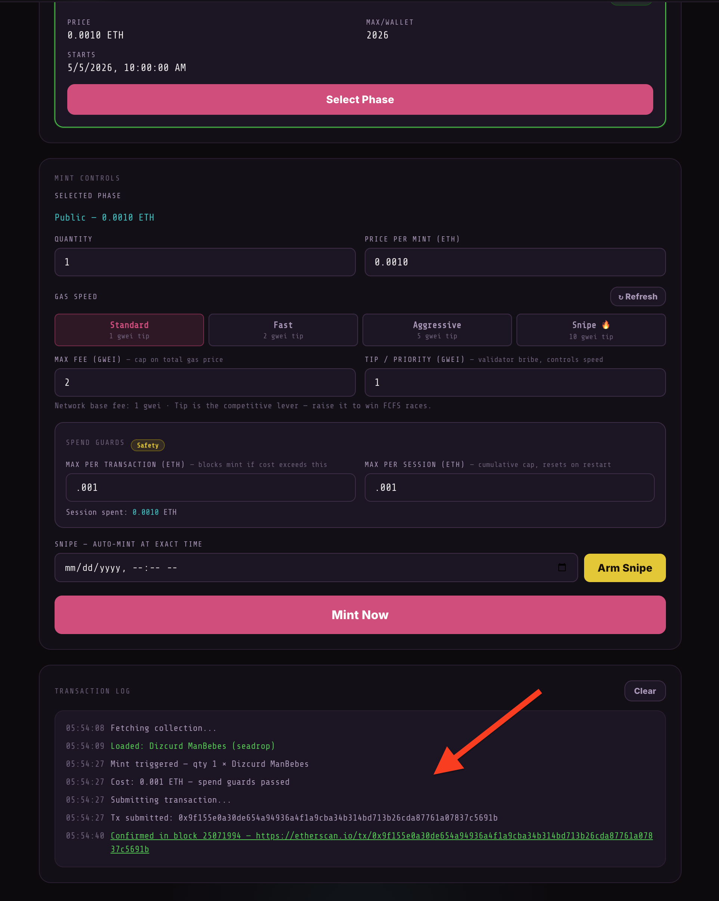

# claude-monitor

Mac menu bar app that monitors Claude Pro usage in real time.

Shows 5-hour and 7-day token usage windows with animated progress bars. Icon turns yellow at 60% and red at 80%. Auto-starts on login, zero config after first setup.



## Stack

Python, PyObjC, WKWebView

## Setup

**1. Install dependencies**
```bash
pip3 install requests pillow pyobjc-framework-Cocoa pyobjc-framework-WebKit
```

**2. Generate the icon**
```bash
python3 make_icon.py
```

**3. Get your session key**

Open claude.ai in Chrome → DevTools → Application → Cookies → copy the `sessionKey` value (starts with `sk-ant-sid02-`).

**4. Run**
```bash
python3 monitor.py
```

On first launch, click the menu bar icon → Settings (gear icon) → paste your session key.

**5. Auto-start on login**
```bash
cp com.mfbrat.claude-monitor.plist ~/Library/LaunchAgents/
launchctl load ~/Library/LaunchAgents/com.mfbrat.claude-monitor.plist
```

## Features

- 5-hour and 7-day usage shown in menu bar title (`18% · 49%`)
- Progress bars with MFbrat colors (pink → yellow → red as usage climbs)
- Reset countdown: shows `Xd Yh` format for resets more than 24h out
- Extra credits balance if enabled on your account
- Refresh button, settings panel, direct link to claude.ai
- Refreshes every 60 seconds
