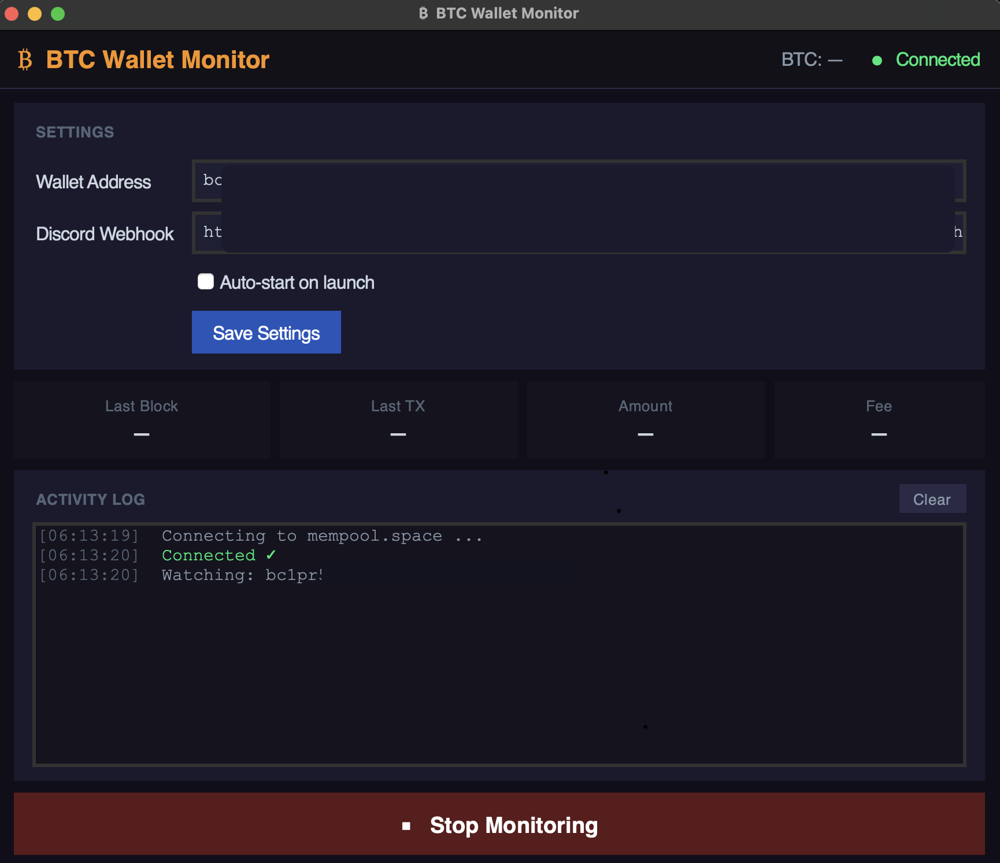

# ₿ BTC Wallet Monitor (beta)

A native macOS desktop app for monitoring a Bitcoin (Taproot) wallet address in real time using [mempool.space](https://mempool.space). No browser required — runs as a standalone double-clickable app.



---

## Features

- 🔴 Live mempool.space WebSocket connection
- ₿ Real-time BTC price from mempool.space API
- ⬇ Incoming / ⬆ Outgoing transaction detection with USD value
- 🧱 New block notifications
- 🔔 Optional Discord webhook alerts
- 💾 Settings persist between sessions (`~/.btc_monitor_config.json`)
- ♻️ Auto-reconnect with exponential backoff
- 🖥 Dark theme, no browser, no localhost

---

## Download (macOS)

> **No Python required** — download the pre-built app:

1. Download `BTCWalletMonitor.zip` from [Latest release](https://github.com/mfBRAT/mf-monitor-safu/releases/latest)
2. Unzip and drag `BTCWalletMonitor.app` to your Applications folder
3. Right-click → Open (first launch only, to bypass Gatekeeper)
4. Enter your wallet address and click **Start Monitoring**

---

## Build from Source

### Prerequisites

```bash
brew install python@3.13 python-tk@3.13
pip3.13 install pyinstaller websockets requests --break-system-packages
```

### Build

```bash
git clone https://github.com/mfBRAT/mf-monitor-safu.git
cd mf-monitor-safu
chmod +x build.sh
./build.sh
```

This produces:
- `dist/BTCWalletMonitor.app` — double-clickable macOS app
- `BTCWalletMonitor.zip` — ready to upload to GitHub Releases

### Run without building

```bash
pip3.13 install websockets requests --break-system-packages
python3.13 btc_monitor_app.py
```

---

## Discord Alerts

Paste a Discord webhook URL in the settings panel. When a transaction is detected on your address, the bot posts an embed with direction, amount in BTC + USD, fee, and a link to the tx on mempool.space.

---

## Privacy

- No data is sent anywhere except mempool.space (WebSocket) and optionally your own Discord webhook
- Your wallet address is stored locally at `~/.btc_monitor_config.json`
- No tracking, no accounts, no cloud

---

## Stack

- Python 3.13
- tkinter (GUI)
- websockets (mempool.space WebSocket API)
- requests (price + Discord)

---

## License

MIT
